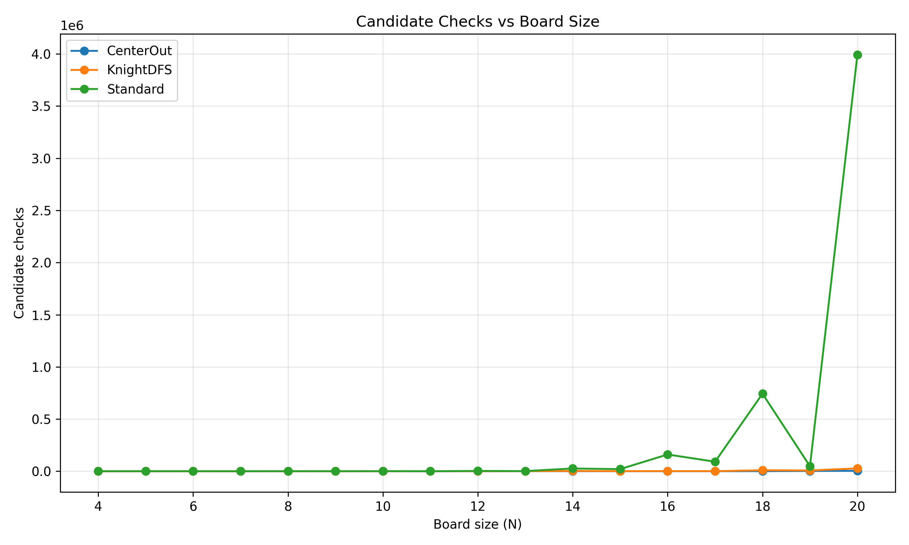
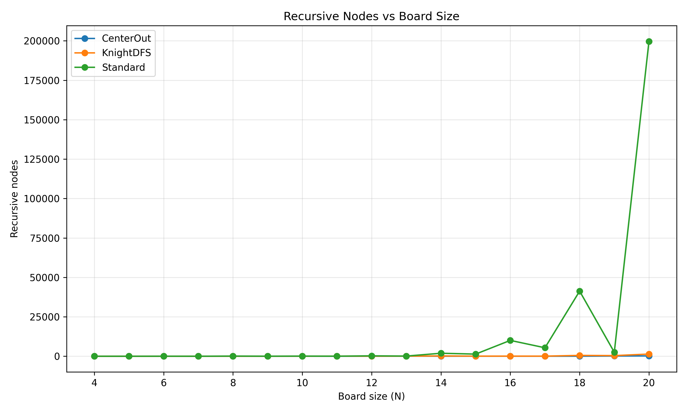
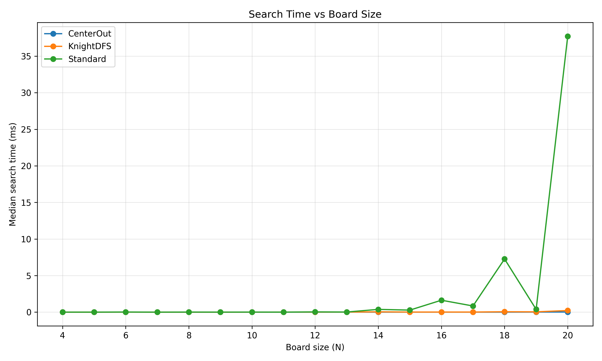
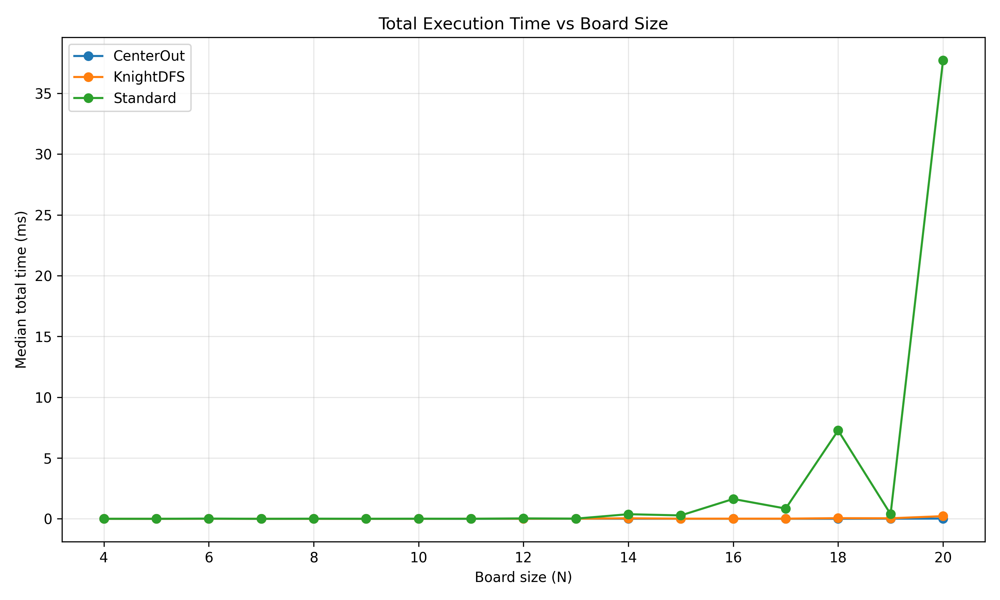

# N-Queens Search Lab

A Java-based experimental project that investigates how **candidate-ordering strategies affect the performance of backtracking algorithms** for the N-Queens problem.

The project implements three different candidate-ordering strategies using a shared backtracking engine. It compares their search behaviour through node counts, candidate checks, placements, backtracks and execution time.

The objective is to understand how changing the order in which candidate positions are explored affects the process of finding the first valid N-Queens solution.

---

## Table of Contents

- [Overview](#overview)
- [Search Strategies](#search-strategies)
- [Project Architecture](#project-architecture)
- [How It Works](#how-it-works)
- [Technologies](#technologies)
- [Requirements](#requirements)
- [Setup and Execution](#setup-and-execution)
- [Benchmarking](#benchmarking)
- [Analysis and Visualisation](#analysis-and-visualisation)
- [Evaluation Metrics](#evaluation-metrics)
- [Limitations](#limitations)
- [Future Scope](#future-scope)

---

## Overview

The N-Queens problem requires placing N queens on an N × N chessboard such that no two queens attack each other.

A standard backtracking algorithm places one queen per row and explores candidate columns while checking whether each placement is valid.

This project investigates whether changing the order in which candidate columns are explored can reduce the search effort required to find a solution.

Three strategies are evaluated:

1. Standard left-to-right ordering.
2. Knight-move DFS-based ordering.
3. Center-out ordering.

All three strategies use the same solver and safety-checking mechanism. This keeps the underlying search algorithm consistent and allows candidate ordering to be studied independently.

## Search Strategies

### 1. Standard Ordering

The standard strategy examines columns sequentially from left to right.

For every row, the candidate order is:

`0, 1, 2, 3, ..., N-1`

This serves as the baseline against which the alternative strategies are compared.

### 2. Knight-DFS Ordering

This strategy derives candidate-column ordering through a Depth-First Search traversal of the chessboard using knight moves.

The implementation:

- Starts traversal from the bottom-right square.
- Uses the eight possible knight-move offsets.
- Visits unvisited squares using DFS.
- Restarts traversal from unvisited squares in row-major order when necessary.
- Extracts the order in which columns are visited for each row.

The resulting per-row column sequences are used by the shared backtracking solver.

The preprocessing phase is performed when the strategy is constructed.

### 3. Center-Out Ordering

The center-out strategy prioritises columns near the centre of the board before exploring positions farther away.

For example, for N = 7, the candidate order is:

`3, 2, 4, 1, 5, 0, 6`

This strategy explores central positions first and progressively moves towards the edges.

---

## Project Architecture

The project separates the backtracking engine, candidate-ordering strategies, benchmarking utilities and analysis scripts.

```text
NQueensSearchLab/
│
├── src/
│   └── nqueens/
│       ├── Main.java
│       │
│       ├── core/
│       │   ├── Board.java
│       │   ├── NQueensSolver.java
│       │   ├── SearchResult.java
│       │   └── SolutionValidator.java
│       │
│       ├── strategies/
│       │   ├── SearchStrategy.java
│       │   ├── StandardOrdering.java
│       │   ├── KnightDFSOrdering.java
│       │   └── CenterOutOrdering.java
│       │
│       └── benchmark/
│           ├── BenchmarkResult.java
│           ├── BenchmarkRunner.java
│           └── CsvExporter.java
│
├── tests/
│
├── analysis/
│   ├── analyze_results.py
│   ├── requirements.txt
│   └── README.md
│
├── docs/
│
├── results/
│   ├── benchmark.csv
│   ├── figures/
│   │   ├── candidate_checks.png
│   │   ├── nodes.png
│   │   ├── search_ms.png
│   │   └── total_ms.png
│   └── README.md
│
├── README.md
├── .gitignore
└── LICENSE
```

### Core Components

| Component | Responsibility |
|---|---|
| `NQueensSolver` | Implements shared backtracking logic |
| `SearchStrategy` | Defines the candidate-ordering interface |
| `StandardOrdering` | Provides sequential column ordering |
| `KnightDFSOrdering` | Generates ordering through knight-move DFS |
| `CenterOutOrdering` | Generates centre-first ordering |
| `SolutionValidator` | Independently validates generated solutions |
| `BenchmarkRunner` | Executes benchmark experiments |
| `BenchmarkResult` | Stores benchmark measurements |
| `CsvExporter` | Exports benchmark results to CSV |

---

## How It Works

The solver follows a row-by-row backtracking approach.

1. Start with the first row.
2. Retrieve the candidate-column ordering from the selected strategy.
3. Examine candidate columns one at a time.
4. Check whether the current position is safe.
5. Place a queen if the position is valid.
6. Recursively process the next row.
7. Backtrack when no valid continuation exists.
8. Stop when the first complete solution is found.

The solver uses column and diagonal occupancy checks to determine whether a placement is valid.

The same solver is reused for all three strategies. Only the candidate exploration order changes.

---

## Technologies

- **Java:** Backtracking engine, search strategies and benchmarking.
- **Python:** Benchmark data analysis and graph generation.
- **Pandas:** CSV data processing.
- **Matplotlib:** Data visualisation.
- **PowerShell:** Compilation and execution environment.

No external Java libraries are required.

---

## Requirements

- Java JDK 17 or later recommended.
- Python 3.9 or later recommended.
- pip.
- VS Code (optional).

Verify Java:

```powershell
java -version
javac -version
```

Verify Python:

```powershell
python --version
pip --version
```

---

## Setup and Execution

Run all commands from the project root directory.

### 1. Compile the Java source files

```powershell
New-Item -ItemType Directory -Force out | Out-Null

javac -d out (Get-ChildItem -Recurse src -Filter *.java).FullName
```

### 2. Run a solution demonstration

For an 8 × 8 board:

```powershell
java -cp out nqueens.Main 8
```

Change `8` to experiment with another board size.

### 3. Run correctness tests

Compile the test files:

```powershell
javac -cp out -d out (Get-ChildItem -Recurse tests -Filter *.java).FullName
```

Run the validation tests:

```powershell
java -cp out nqueens.tests.ValidationTests
```

Expected output:

```text
All validation smoke tests passed for N=1..20.
```

---

## Benchmarking

The benchmark runner compares all three strategies over a specified range of board sizes.

Execute:

```powershell
java -cp out nqueens.Main benchmark 4 20 3 7
```

Arguments:

| Argument | Description |
|---|---|
| `4` | Minimum board size |
| `20` | Maximum board size |
| `3` | Number of warm-up runs |
| `7` | Number of measured repetitions |

For every board size, the benchmark evaluates:

- Standard ordering
- Knight-DFS ordering
- Center-out ordering

Warm-up runs are excluded from the measured repetitions.

The benchmark exports its results to:

`results/benchmark.csv`

The CSV contains the search statistics and timing measurements for each strategy.

---

## Analysis and Visualisation

The Python analysis script reads the generated benchmark CSV and produces visual comparisons between the strategies.

### Install dependencies

```powershell
pip install -r analysis/requirements.txt
```

### Run analysis

```powershell
python analysis/analyze_results.py
```

Generated figures are saved in:

`results/figures/`

### Generated Visualisations

**1. Candidate Checks**



Compares the number of candidate positions examined by each strategy.

**2. Search Nodes**



Compares the number of recursive search nodes visited.

**3. Search Execution Time**



Compares the measured time spent executing the search.

**4. Total Execution Time**



Compares the reported total execution time, including preprocessing where measured.

---

## Evaluation Metrics

The project records the following metrics:

| Metric | Description |
|---|---|
| Nodes | Number of recursive search nodes visited |
| Candidate Checks | Number of candidate positions examined |
| Placements | Number of successful queen placements |
| Backtracks | Number of unsuccessful branches requiring backtracking |
| Preprocessing Squares | Number of board squares visited during Knight-DFS preprocessing |
| Preprocessing Time | Time spent constructing the candidate ordering |
| Search Time | Time spent finding the first solution |
| Total Time | Combined preprocessing and search time |

Search effort and execution time are considered separately because a reduction in candidate checks does not necessarily translate into a proportional reduction in execution time.

---

## Limitations

- The solver searches for the first valid solution rather than enumerating every possible solution.
- The experiment changes candidate ordering, not the underlying backtracking algorithm.
- The benchmark results are dependent on the execution environment and JVM behaviour.
- Candidate checks and recursive node counts measure search effort, not execution time.
- Knight-DFS introduces an additional preprocessing phase.
- Results for N = 4 through N = 20 do not establish universal performance superiority.
- The project does not claim that the ordering strategies are novel without a supporting literature review.

---

## Future Scope

Potential extensions include:

- Evaluating larger board sizes.
- Comparing additional candidate-ordering heuristics.
- Studying the effect of ordering on complete solution enumeration.
- Comparing different search-space exploration techniques.
- Extending the experimental analysis across multiple hardware environments.
- Reviewing existing N-Queens research to establish the relationship between these strategies and prior work.

---

## Conclusion

NQueensSearchLab provides an experimental framework for studying how candidate-ordering decisions influence backtracking search.

By keeping the solver constant and varying only candidate ordering, the project makes it possible to compare different exploration strategies using consistent search metrics and execution-time measurements.

The results provide a basis for further investigation into search heuristics and their impact on combinatorial problem-solving.
